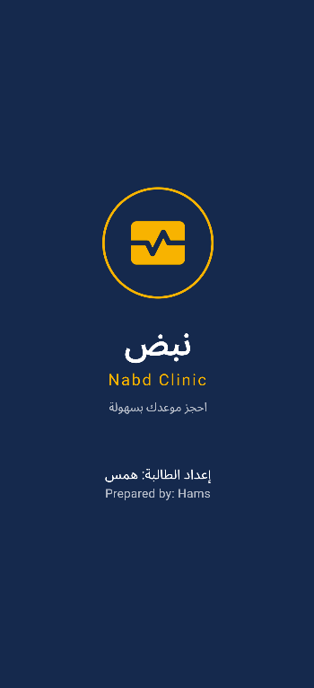
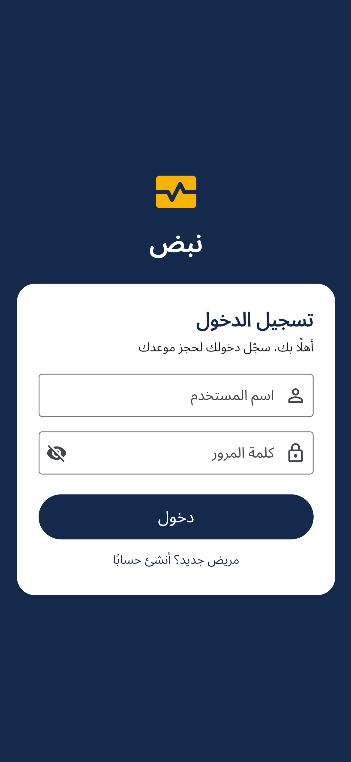
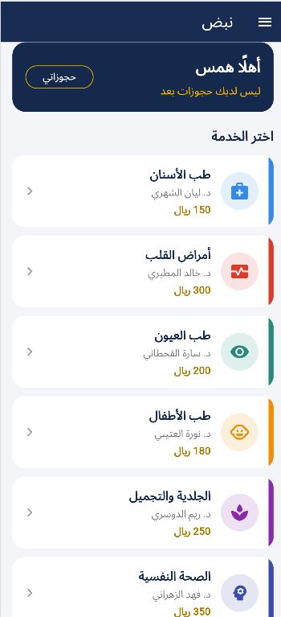
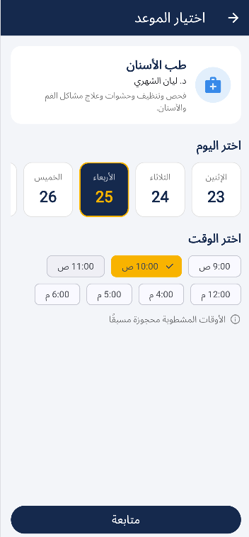
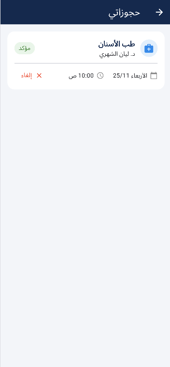

# نبض | Nabd Clinic

## بالعربية

**اسم التطبيق:** نبض (Nabd Clinic)
**اسم الطالبة:** همس ماجد ظافر الاسمري

### فكرة التطبيق
تطبيق لحجز مواعيد العيادة: تسجّل الطالبة دخولها، وتختار الخدمة (التخصص)، ثم اليوم والوقت، وتؤكد الحجز، وتتابع حجوزاتها.

### الشاشات
الافتتاحية، تسجيل الدخول، إنشاء حساب، الرئيسية (الخدمات)، اختيار الموعد، تأكيد الحجز، حجوزاتي.

### شرح التطبيق والتنقل
- الشاشة الافتتاحية تنتقل تلقائيًا بعد 3 ثوان إلى تسجيل الدخول، ومنه إلى إنشاء حساب.
- الحسابات تُحفظ في `List` داخل التطبيق فقط (بدون قاعدة بيانات)، وتظهر رسالة خطأ عند: حقل فارغ، اسم مستخدم مسجّل مسبقًا، بيانات دخول غير صحيحة.
- من الشاشة الرئيسية نختار خدمة فتنتقل الخدمة المختارة إلى شاشة اختيار الموعد، ثم تنتقل بيانات الحجز إلى شاشة التأكيد، وبعد التأكيد تظهر شاشة حجوزاتي.
- يوجد قائمة جانبية للتنقل بين الرئيسية وحجوزاتي وتسجيل الخروج.

### الميزة الإضافية
**إلغاء الحجز برسالة تأكيد:** في شاشة حجوزاتي يظهر زر إلغاء، وتظهر رسالة تسأل قبل الحذف. كذلك الأوقات المحجوزة مسبقًا تظهر معطلة ومشطوبة ولا يمكن حجزها مرتين.

### صور الشاشات
|الافتتاحية |  تسجيل الدخول  |
|---|---|
|  |  |

|الرئيسية |اختيار الوقت |
|---|---|
|  |  |

|حجوزاتى |
|---|---|
|  |

### فيديو التطبيق
[رابط الفيديو على Google Drive](https://drive.google.com/file/d/1gDOB0Lk41SPtVnyKESMar7BPFa2_dKX2/view?usp=sharing)

---

## English

**App name:** Nabd Clinic
**Student name:** Hams Majed Dhafer Alasmari

### App idea
A clinic appointment booking app: the student logs in, chooses a service (specialty), then a day and a time, confirms the booking, and follows her bookings.

### Screens
Splash, Login, Register, Home (services), Choose appointment, Confirm booking, My bookings.

### How the app works
- The splash screen moves automatically to the login screen after 3 seconds, and from login we can go to register.
- Accounts are stored in a `List` inside the app only (no database). An error message is shown for: an empty field, a username that is already registered, and wrong login data.
- From the home screen we choose a service, and the selected service is passed to the appointment screen. Then the booking data is passed to the confirm screen, and after confirming the My bookings screen appears.
- A side menu is used to move between Home, My bookings and Logout.

### Extra feature
**Cancel a booking with a confirmation message:** the My bookings screen has a cancel button and a dialog asks before deleting. Also, times that are already booked appear disabled and crossed out, so they cannot be booked twice.

### Screenshots

|---|---|
|  |  |

|---|---|
|  |  |

|---|---|
| [appointments](screenshots/s7_my_appointments.png) |

### Demo video
[Google Drive video link](https://drive.google.com/file/d/1gDOB0Lk41SPtVnyKESMar7BPFa2_dKX2/view?usp=sharing)
